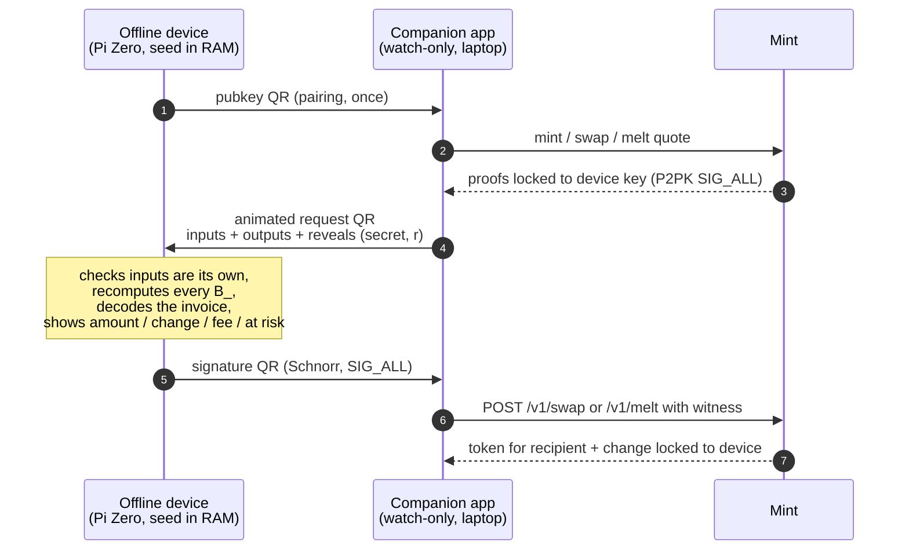

# NutSigner

An offline signer for Cashu ecash, built for Nut November 2026.

Ecash is locked to a key that lives only on an offline device (NUT-11 P2PK with
`SIG_ALL`). The proofs sit in a watch-only wallet on the laptop and are
worthless without the device's signature. `SIG_ALL` covers every input **and
every output**, so a compromised laptop can't reuse a signature to redirect
the money.
## On device demo -:

https://github.com/user-attachments/assets/f78d27ff-aac9-4c13-ae06-ccb78e4193f0

## Final updated UI demo emulated (No functional changes except the /web frontend)-:

https://github.com/user-attachments/assets/0b81feb0-682a-4807-9782-1547b2e411cc


## What works

- **Fund, send, receive, pay** (NUT-04 mint, `SIG_ALL` swap, NUT-05 bolt11 melt with NUT-08 change), tested on testnut.
- **Send to another NutSigner**: `--to` locks the coins to the recipient's device key.
- **Crash recovery** (NUT-07, NUT-09): an interrupted fund, swap or melt finishes with `recover`.
- **QR transport**: compact binary request as an animated BC-UR QR, signature back as one QR.
- **Companion app**: a watch-only wallet with a browser UI (see [below](#companion-app-watch-only-wallet)).
- **Offline device**: a SeedSigner fork on a Pi Zero (see [below](#offline-device-seedsigner-fork)).
- NUT-00 and NUT-11 `SIG_ALL` pass the official test vectors.

## How it works



The device classifies every output as **change** (locked back to itself),
**locked** (to another key, shown on screen), **bearer**, or **unverified**
(warned). A request whose reveals don't match its `B_` values is rejected.

For a melt the device decodes the bolt11 invoice and requires its amount to
match the quote. Offline it can't tell whether the quote id belongs to that
invoice, so it shows **every input as at risk** and applies its limit to the
input total.

Keys are derived from a BIP-39 seed at `m/129372'/11'/0'/0/0`.

## Companion app (watch-only wallet)

The laptop side: a watch-only wallet with a browser UI. It holds the proofs
but **no seed**. It only learns the device's public key, by scanning it from
the device's screen, so the coins can't be spent from the laptop alone.

**Setup** (Python 3, Node 20.19+):

```bash
python3 -m venv .venv && source .venv/bin/activate
pip install -r requirements-host.txt
(cd web && npm install && npm run build)
python3 companion.py --wallet alice.json      # opens http://127.0.0.1:8338
```

| Flag | Meaning |
| --- | --- |
| `--wallet` | wallet file; each file belongs to one mint |
| `--mint` | mint URL (default: testnut, fake ecash) |
| `--port` | port (default: 8338) |
| `--no-browser` | don't open a browser tab |

The app listens on 127.0.0.1 only and its API requires a token that is new
each run. It runs `recover` on start; if a request is interrupted, press
**Recover** and nothing is lost.

**Signing flow:**

1. **Pair.** On the device, open Tools → Cashu → Show pubkey and hold it up to
   the webcam.
2. **Request.** Fund, Send, Receive or Pay invoice in the app. It shows an
   animated request QR.
3. **Sign.** On the device, Scan the QR, check the screens and approve.
4. **Submit.** In the app, press **Scan signature** and show the device's
   signature QR to the webcam.

[`docs/DEMO.md`](docs/DEMO.md) walks through the full two-user demo,
including a tampered request being rejected.

**Tests:**

```bash
python3 -m unittest discover -s tests -t .
(cd web && npm test)
```

## Offline device (SeedSigner fork)

The device side: [SeedSigner](https://github.com/SeedSigner/seedsigner) with a
Cashu signer added, on the
[`cashu-melt`](https://github.com/Sansh2356/seedsigner/tree/cashu-melt) branch
of the fork. Upstream wallet features are unchanged. The seed is loaded from a
SeedQR or typed words and stays in RAM.

**Changes:**

- **Signing core** (`src/seedsigner/nutsigner/`): a copy of this repo's device
  code (`device.py`, `crypto.py`, `wire.py`, `bolt11.py`, `curve.py`). It
  needs only `embit`, which SeedSigner already ships.
- **Screens** (`views/cashu_views.py`):
  - Tools → Cashu → Show pubkey pairs the device with the companion app.
  - A scanned request opens a review: send, receive or pay invoice, with
    change, fee, mint and the amount at risk.
  - Approving shows the signature QR. A tampered or invalid request is
    rejected with the reason.
- **Scanner**: the main Scan recognises NutSigner requests (`ur:bytes` with an
  `NS` v2 header) next to SeedQRs and PSBTs.
- **Camera**: a picamera2 backend for Raspberry Pi OS Bookworm.

**Run** on the Pi, from the fork's checkout:

```bash
PYTHONPATH=src .venv/bin/python src/main.py
```

**Tests:** flow tests for every request type, and a headless emulator that
drives the real screens with scripted buttons and QR images as the camera:

```bash
python -m pytest tests/test_flows_cashu.py tests/test_emulator_cashu.py
python tests/emulator.py --seed-words "..." frame1.png frame2.png   # --real-camera on the Pi
```

Tested end to end on a Pi Zero 1.3 (Waveshare 1.3" LCD HAT, OV5647 camera)
against testnut.

## Threat model

**Protects against** a compromised laptop or phone (malware, a malicious
extension, a stolen unlocked device). Locked proofs can't be spent without the
device, and changing any input, amount or `B_` after signing makes the mint
reject the request.

**Does not protect against:**

- **The mint.** It can fail, rug or censor. Keep amounts small.
- **The host keeping a bearer token.** Send with `--to` so the output is useless to the host.
- **A swapped melt quote.** This is capped by the at-risk input total shown on the device.
- **Physical attacks.** The Pi Zero is not a secure element.

## Layout

```
nutsigner/     crypto, device review + signing, wire format, bolt11, QR, mint client, host wallet
companion.py   companion app: local JSON API serving web/
web/           companion UI (React, Vite)
host_cli.py    CLI host wallet (development)
device_cli.py  laptop stand-in for the device (development)
tests/         spec vectors, flow + attack tests, crash recovery, offline test mint
```
